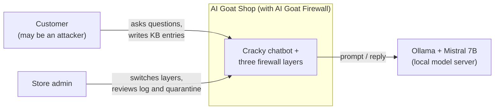
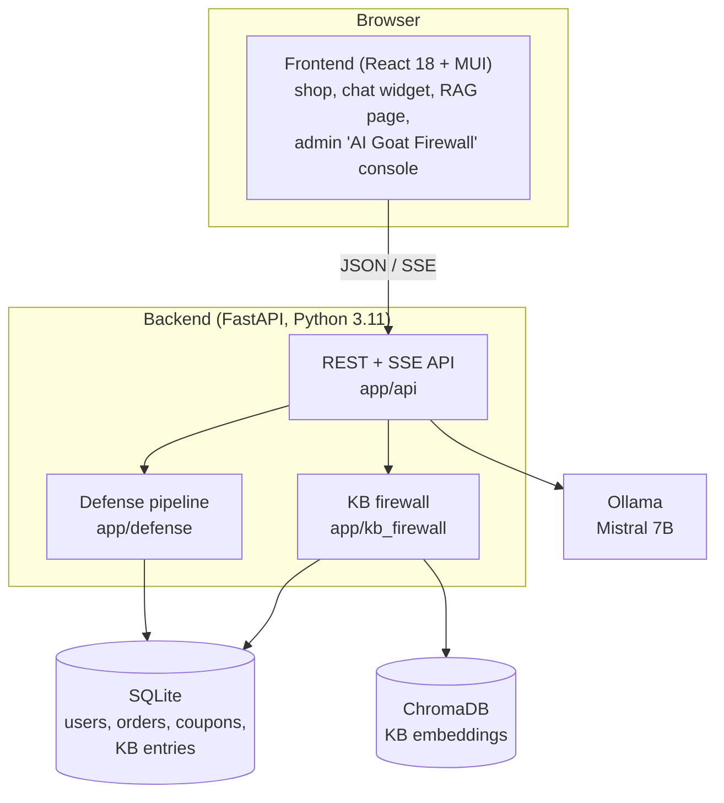
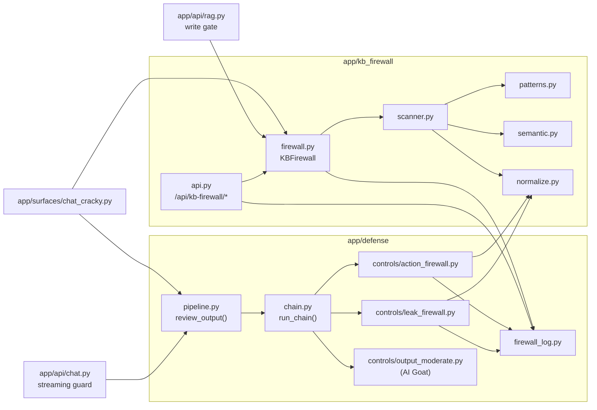
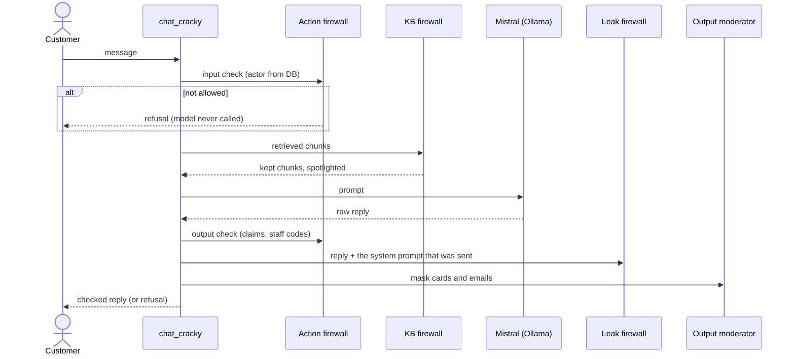
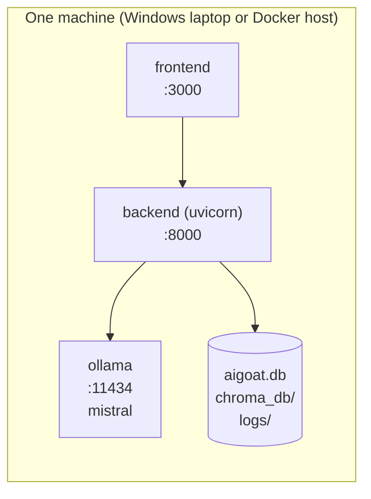
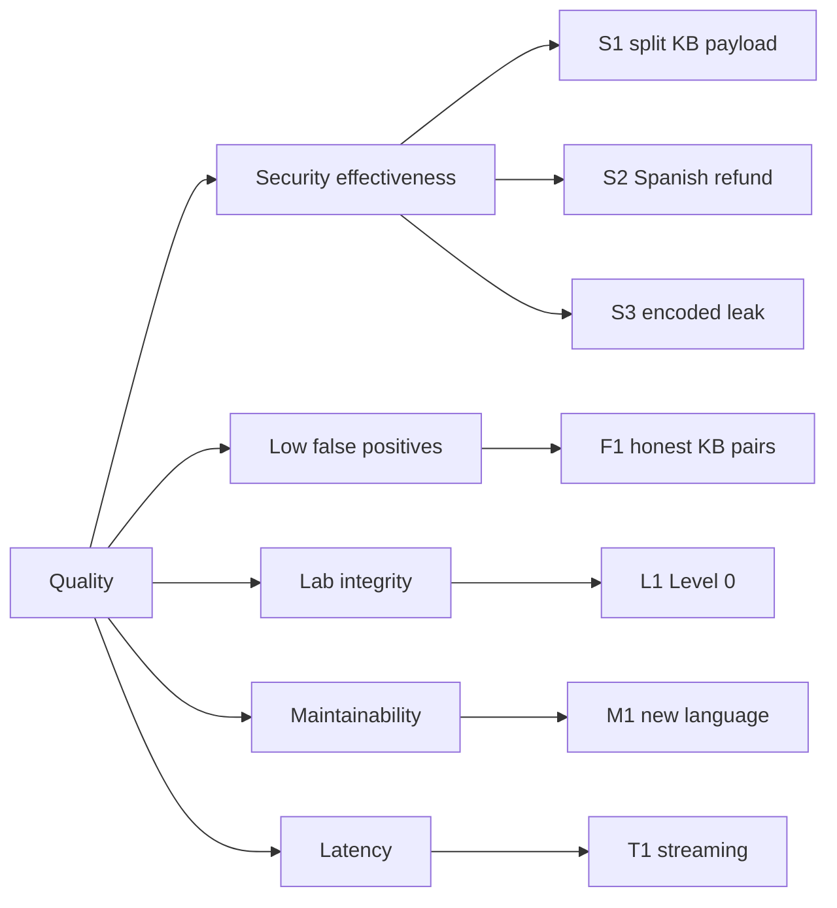

# AI Goat Firewall: Architecture

This document follows the [arc42](https://arc42.org) template (12 sections) and draws its diagrams
with the [C4 model](https://c4model.com) levels (context, container, component). Decisions are kept
as separate [Architecture Decision Records](decisions/README.md). Everything describes the code on
the `christopher/unified-firewall` branch.

| Item | Value |
|---|---|
| System | AI Goat Firewall: three defensive layers added to the AI Goat shop chatbot (Cracky) |
| Authors | Christopher Aguilar Mendez, Simon Grondin and Jeremiah Kisamba Mwamba, Bishop's University AI Cybersecurity Challenge 2026 |
| Status | Implemented and tested (215 firewall tests, 90% line coverage of firewall code) |
| Related | [Code structure](CODE_STRUCTURE.md) · [Documentation index](README.md) |

---

## 1. Introduction and goals

### 1.1 Requirements overview

AI Goat is a deliberately vulnerable AI security training range. Its chatbot, Cracky, answers
customers with a language model (Mistral 7B on Ollama), a knowledge base searched by similarity
(RAG), and a system prompt that sometimes holds secrets. We found three attacks that get through its
stock defenses, and built one layer per attack:

| Layer | Stops | Main AI Goat labs | OWASP LLM Top 10 (2025) |
|---|---|---|---|
| **KB firewall** | Knowledge-base poisoning: hidden instructions in KB entries, also split across entries | `llm01-4`, `llm01-5`, `llm09-1`, `llm09-3` | LLM01, LLM08 |
| **Action firewall** | Refunds, coupons, exports and order changes the logged-in user is not allowed | `llm03-3` | LLM06 |
| **Leak firewall** | Replies that reveal secrets from the system prompt, even encoded, or copy its rules | `llm01-1`, `llm01-3`, `llm02-1`, `llm08-1` | LLM07, LLM02 |

### 1.2 Quality goals

Ranked; the first one wins when two conflict.

| # | Quality goal | What it means here | Measured by |
|---|---|---|---|
| 1 | **Security effectiveness** | Each layer stops its attack class, including other languages and hidden text | Benchmarks in `eval/`, live runs against Mistral |
| 2 | **Low false positives** | Honest customers and store text are not blocked | Honest sets in the benchmarks; 0 of 595 honest KB pairs blocked |
| 3 | **Lab integrity** | Level 0 stays vulnerable; every layer can be switched off at runtime | Tests assert Level 0 behavior; admin switches |
| 4 | **Maintainability and testability** | Small modules, tests without a model, one place to add rules | 215 tests, 90% coverage, radon grade A average |
| 5 | **Latency** | No extra model calls; checks feel instant | Pattern checks under 1 ms per message |

### 1.3 Stakeholders

| Role | Expectation |
|---|---|
| Challenge judges | See each attack work, see it stopped, and understand why the design holds |
| Learners using AI Goat | Labs keep working; firewalls are optional and visible |
| Store admin (in the scenario) | One console to switch layers, review quarantine and read a log |
| Developers (us, upstream maintainers) | Code that fits AI Goat's existing defense architecture and is easy to extend |

## 2. Architecture constraints

| Constraint | Consequence |
|---|---|
| Build on the upstream AI Goat code base (FastAPI, SQLAlchemy, React/MUI) | New code lives in AI Goat's packages and plugs into its control pipeline instead of a separate service |
| Runs fully local (Ollama, SQLite, ChromaDB, local embeddings) | No cloud APIs; the embedding model must already be on disk (`local_files_only`) |
| Level 0 must stay vulnerable for the labs | Chat firewalls run only at Levels 1 and 2; KB firewall is off by default |
| Python 3.11, `ruff` and `pyflakes` in CI, React build with `CI=true` | Code must pass lint with zero warnings |
| Team of three, about one week | Prefer deterministic code over training models; reuse AI Goat's patterns |

## 3. Context and scope

### 3.1 Business context (C4 level 1)

| Partner | Input | Output |
|---|---|---|
| Customer | Chat messages; knowledge-base entries | Replies (checked); refusals |
| Store admin | Switches, quarantine releases, scanner text | Status, counters, live log |
| Ollama (Mistral 7B) | Prompts that already passed the input and KB checks | Raw replies, checked before display |

### 3.2 Technical context

| Channel | Protocol | Notes |
|---|---|---|
| Browser → frontend | HTTP, port 3000 | React single-page app |
| Frontend → backend | REST + Server-Sent Events, port 8000, JWT bearer | `/api/chat/stream` streams replies |
| Backend → Ollama | HTTP, port 11434 | Streaming generation |
| Backend → storage | SQLite file `aigoat.db`; ChromaDB folder `chroma_db/` | Local files |

## 4. Solution strategy

| Goal | Approach | Decision |
|---|---|---|
| Security that a prompt cannot argue with | Decide in code with facts: database ownership, the prompt that was sent, who wrote a KB entry | [ADR-0002](decisions/0002-enforce-in-code-not-with-an-llm-judge.md) |
| Fit AI Goat instead of forking its chat | Implement chat layers as `DefenseControl`s listed in `defense_profiles.yml` | [ADR-0003](decisions/0003-build-on-the-control-pipeline.md) |
| One answer to hiding tricks | One shared normalizer used by all three layers | [ADR-0004](decisions/0004-one-shared-normalizer.md) |
| No single word decides | Weighted signals combined with noisy-OR, threshold 0.6 | [ADR-0005](decisions/0005-noisy-or-risk-scoring.md) |
| Catch instructions cut in half | Score untrusted retrieved chunks together, with a framing requirement | [ADR-0006](decisions/0006-score-untrusted-chunks-together.md) |
| Leak detection that survives translation | Compare replies with the real system prompt's secrets | [ADR-0007](decisions/0007-compare-replies-with-the-real-system-prompt.md) |
| Nothing blocked ever reaches the screen | Release streamed replies one checked sentence at a time | [ADR-0008](decisions/0008-release-streams-sentence-by-sentence.md) |
| One console for operators | Shared in-memory event log + action audit file | [ADR-0009](decisions/0009-one-event-log-for-three-firewalls.md) |
| Keep the labs intact | Level 0 untouched, runtime switches per layer | [ADR-0010](decisions/0010-level-zero-stays-vulnerable.md) |

## 5. Building block view

### 5.1 Containers (C4 level 2)

### 5.2 Components (C4 level 3): the firewall inside the backend

| Building block | Responsibility | Key interface |
|---|---|---|
| `kb_firewall/normalize.py` | Undo hiding tricks: NFKC, invisible characters, look-alike letters, base64, spaced letters, digit swaps | `normalize(text) -> Normalized` |
| `kb_firewall/patterns.py` | Ten cue categories in five languages, each with a weight | `match_cues(text)` |
| `kb_firewall/semantic.py` | Sentence embeddings compared with attack and benign banks | `SemanticScanner.score(text)` |
| `kb_firewall/scanner.py` | Combine signals into one risk (noisy-OR); combine several verdicts | `Scanner.scan()`, `Scanner.combine()` |
| `kb_firewall/firewall.py` | Write gate, read gate, split-payload check, spotlighting, counters | `check_write()`, `filter_chunks()`, `spotlight()` |
| `kb_firewall/api.py` | Admin API for all three layers: status, toggle, events, scan, quarantine | `/api/kb-firewall/*` (admin only) |
| `defense/controls/action_firewall.py` | Detect actions (5 languages, normalized second reading) and check them against the account | `firewall_verdict()`, `ActionFirewallControl` |
| `defense/controls/leak_firewall.py` | Extract secrets from the sent prompt; search the reply in several readings; detect copied rules | `leak_verdict()`, `LeakFirewallControl` |
| `defense/firewall_log.py` | One in-memory ring of events and counters for the console | `record()`, `recent()`, `counts()` |
| `defense/pipeline.py` | Run output controls, report which control acted | `review_output() -> OutputReview` |
| `api/chat.py` | Release streamed replies sentence by sentence after review | `_release_point()`, `_update_events()` |
| `frontend/.../KbFirewallPage.jsx` | Admin console: three switches, counters, merged log, quarantine, scanner | React component |

## 6. Runtime view

### 6.1 A chat message at Level 1 (non-streaming path)

### 6.2 Streaming without flashing

1. Tokens from Ollama are collected in a buffer.
2. At each sentence end, `review_output()` checks **all** text so far with the output controls
   (`preview=True`, so only refusals are logged).
3. Passing text is sent as a delta; a refusal is sent as a `replace` event and the Ollama stream is
   closed (`aclose()`), which stops generation.
4. After the stream ends, the normal full check runs once more and is logged.

### 6.3 Writing a KB entry

1. `POST`/`PUT /api/knowledge-base/`: only the owner or staff may edit; the server sets `trust_tier`.
2. `check_write()` scans title + content. Flagged text is stored with tier `quarantined`.
3. Quarantined entries are never given to the model until an admin releases them.

### 6.4 Admin flips a switch

`POST /api/kb-firewall/toggle` with any of `enabled`, `mode`, `action_enabled`, `leak_enabled`.
Settings change in memory immediately; no restart. Omitted fields keep their value.

## 7. Deployment view

| Option | How | Notes |
|---|---|---|
| Native (used for the challenge) | `scripts/start.sh` (from PowerShell: `& "C:\Program Files\Git\bin\bash.exe" scripts/start.sh`) | Starts Ollama, seeds data, runs backend and frontend |
| Docker | `docker/docker-compose.yml`: services `ollama`, `backend`, `frontend` | Volumes for database and models |
| CI | `.github/workflows/ci.yml`: backend lint, backend tests, frontend tests + build, Docker build | Runs on push |

## 8. Cross-cutting concepts

| Concept | How it works | Where |
|---|---|---|
| **Defense levels** | Level 0 none; Level 1 adds input checks, action and leak firewalls, output moderation; Level 2 adds NeMo rails | `config/defense_profiles.yml` |
| **Facts over words** | Words find the action or secret; the decision uses the DB (orders, coupons, accounts), the sent prompt, or the KB entry's trust tier | Action and leak firewalls, KB read gate |
| **Normalization** | One function undoes hiding tricks; every layer reads text both as written and normalized | `kb_firewall/normalize.py` |
| **Five languages** | English, Spanish, French, Portuguese, German in KB cues and action words | `patterns.py`, `action_firewall.py` |
| **Configuration** | `config/config.yml` (`kb_firewall:` section), `defense.*_enabled`, env vars `ACTION_FIREWALL_ENABLED`, `LEAK_FIREWALL_ENABLED`; runtime switches through the admin API | `app/core/config.py` |
| **Logging and audit** | Shared in-memory log (300 events) for the console; JSON-lines audit for actions; secrets are masked in logs | `firewall_log.py`, `logs/action_firewall_audit.jsonl` |
| **Security of the firewall itself** | All admin endpoints require an admin JWT; the scanner sandbox is admin-only so attackers cannot tune payloads | `kb_firewall/api.py` |
| **Error handling** | Controls must not swallow errors into "allow" (AI Goat rule); missing embedding model falls back and reports it in status | `defense/control.py`, `semantic.py` |
| **Testing** | Scripted fake LLM; real lab prompts read from `prompts/`; Level 0 asserted vulnerable | `tests/test_*_firewall.py` |

## 9. Architecture decisions

See the [decision log](decisions/README.md) (ten ADRs, Nygard format).

## 10. Quality requirements

### 10.1 Quality tree

### 10.2 Quality scenarios

| ID | Stimulus | Expected response | Evidence |
|---|---|---|---|
| S1 | A customer writes two KB entries that each score below 0.6 | Both dropped at retrieval; Cracky gives the real policy | Live run; `test_instruction_split_across_two_entries_is_blocked` |
| S2 | "Reembolsa el pedido #1003" from a user who doesn't own #1003 | Refused before the model is called | Live run; `test_requests_in_other_languages_are_blocked` |
| S3 | Reply contains the passphrase reversed, in base64, hex, ROT13, or with the tail translated | Reply replaced with a refusal | `test_passphrase_is_caught_however_it_is_written` |
| F1 | Any 2 or 3 honest entries retrieved together | None blocked | 0/595 pairs, 0/6,545 triples |
| L1 | Same attacks at Level 0 | Still succeed | `test_lab_leak_is_stopped_at_level_one_and_open_at_level_zero` |
| M1 | A developer adds a sixth language | Edit one pattern list per layer, add tests | `patterns.py`, `action_firewall.py` regex blocks |
| T1 | A long streamed reply | Text appears sentence by sentence; no extra model call | `tests/test_leak_firewall.py` streaming tests |

## 11. Risks and technical debt

| # | Item | Impact | Mitigation / next step |
|---|---|---|---|
| R1 | Test sets were written by the team that tuned the rules | Numbers are optimistic | Measure on a held-out set (the fresh KB set, `eval/kb_firewall/fresh_dataset.py`) and public sets |
| R2 | Patterns can be studied and evaded | Bypasses with effort | Decisions rest on facts; layers overlap; scanner is admin-only |
| R3 | Paraphrased leaks and multi-message attacks | Not detected | Per-conversation state; meaning-based leak check |
| R4 | Lab level resets when a lab page reloads (AI Goat UI) | A demo may silently run at Level 0 | Workaround: pick Vulnerable, then Hardened; candidate upstream fix |
| D1 | Two functions with high cyclomatic complexity: `_detect_sentence` (43) and `_extract` (41) | Harder to change safely | Split into one function per action/secret kind (sizes in [Code structure §7](CODE_STRUCTURE.md#7-size-and-complexity-at-a-glance)) |
| D2 | `kb_firewall` and `defense` import each other (normalizer, event log) | Package boundary is blurred | Move both to a small shared package |
| D3 | 41% docstring coverage on public functions | Slower onboarding | Add docstrings to public API first |
| D4 | "Confirm" decisions are only a message | No real approval workflow | Approval queue with persistence |

## 12. Glossary

| Term | Meaning |
|---|---|
| Cracky | AI Goat's shop chatbot |
| KB / knowledge base | Store texts searched by similarity and pasted into the prompt |
| RAG | Retrieval-Augmented Generation: look up texts, add them to the prompt, generate |
| Control | A `DefenseControl` subclass that runs at a stage (input, output, ...) of the defense chain |
| Profile | The list of controls for a surface and level, in `defense_profiles.yml` |
| Surface | An entry point AI Goat defends, such as `chat.cracky` |
| Trust tier | Provenance of a KB entry: `system`, `user`, `quarantined`, ... |
| Quarantine | Saved but never shown to the model until an admin releases it |
| Spotlighting | Wrapping KB text in `<kb_document>` tags marked as data |
| Noisy-OR | `risk = 1 − Π(1 − wᵢ)`: independent weak signals add up |
| Split payload | One instruction cut across several KB entries |
| Actor | Snapshot of the logged-in user, their orders, coupons and account names, built from the DB |
| Leak | A reply containing a secret from the system prompt or copying its rules |
