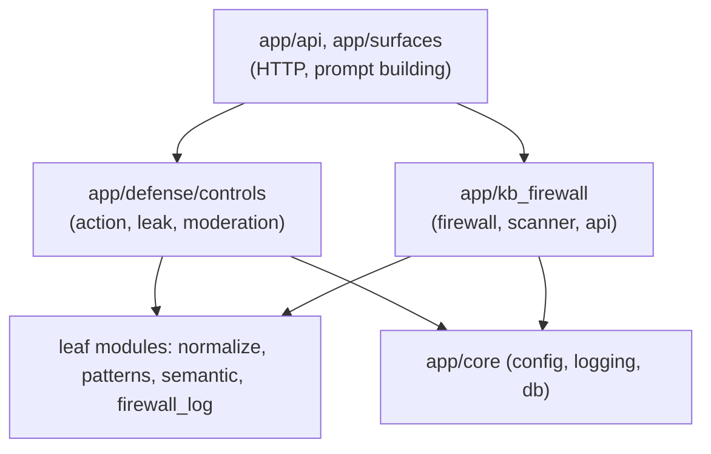

# Code structure guide

Where the AI Goat Firewall code lives, how the pieces depend on each other, the conventions it
follows, and how to extend it. For *why* it is built this way, see the
[architecture document](ARCHITECTURE.md) and its [decision records](decisions/README.md).

## 1. Repository map

Only the parts that matter for the firewall are expanded. Everything else is upstream AI Goat.

```
aigoat-defense/
├── app/                              Backend (FastAPI, Python 3.11)
│   ├── api/
│   │   ├── chat.py                   Chat endpoints; sentence-by-sentence streaming guard
│   │   ├── rag.py                    Knowledge-base CRUD; KB write gate (owner check, quarantine)
│   │   └── challenge_chat.py         Challenge chat; KB read gate
│   ├── core/config.py                Settings: kb_firewall section, *_firewall_enabled, env overrides
│   ├── defense/                      AI Goat's defense pipeline
│   │   ├── control.py                DefenseControl base class, stages, registry   (upstream)
│   │   ├── chain.py                  run_chain(): runs controls in order            (upstream)
│   │   ├── pipeline.py               process_input(), review_output(), moderate_output()
│   │   ├── firewall_log.py           Shared live event log for the three layers     (new)
│   │   ├── rejection.py              Refusal texts (action_blocked, leak_blocked, ...)
│   │   └── controls/
│   │       ├── __init__.py           Registers every control
│   │       ├── action_firewall.py    Action firewall                                (new)
│   │       ├── leak_firewall.py      Leak firewall                                  (new)
│   │       └── output_moderate.py    AI Goat's output moderator (hands off to leak firewall)
│   ├── kb_firewall/                  KB firewall                                    (new)
│   │   ├── normalize.py              Undo hiding tricks (shared by all three layers)
│   │   ├── patterns.py               Ten cue categories, five languages
│   │   ├── semantic.py               Embedding similarity vs attack/benign banks
│   │   ├── scanner.py                Signals → risk (noisy-OR); combine verdicts
│   │   ├── firewall.py               Write gate, read gate, split payloads, spotlighting
│   │   └── api.py                    Admin API for all three layers
│   ├── rag/service.py                RAG lab service; KB read gate
│   └── surfaces/chat_cracky.py       Builds Cracky's prompt; calls the firewalls
├── config/
│   ├── config.yml                    kb_firewall: enabled, mode, model, threshold, margin
│   └── defense_profiles.yml          Which controls run per surface and level
├── frontend/src/components/admin/
│   └── KbFirewallPage.jsx            "AI Goat Firewall" admin console
├── tests/
│   ├── test_kb_firewall.py           KB firewall (30 tests)
│   ├── test_action_firewall.py       Action firewall (131 tests)
│   └── test_leak_firewall.py         Leak firewall + streaming (54 tests)
├── eval/
│   ├── kb_firewall/                  KB benchmark, dataset, live demo script
│   └── firewall/                     Before/after benchmark for all layers, live demo of 3 attacks
├── docs/                             Action and leak firewall guides, upstream lab docs
└── documentation/                    Architecture, decisions, code structure (index: documentation/README.md)
```

## 2. Layers and dependency rules



Rules the code follows:

1. **Leaf modules import nothing from the app.** `normalize.py`, `patterns.py`, `semantic.py` and
   `firewall_log.py` depend only on the standard library (and `sentence_transformers`, loaded lazily).
   They can be tested in isolation.
2. **Controls never import the pipeline.** `app/defense/control.py` states this rule; controls receive
   a `DefenseDecision` and return a `ControlOutcome`.
3. **Decisions read facts from the `DefenseDecision.context`,** never from the prompt text: `actor`
   (built from the DB by `load_actor()`), `system_prompt` (the one actually sent), `preview`.
4. **The HTTP layer decides *when* to check; controls decide *what* is allowed.**

Known exception (debt D2 in the [architecture document](ARCHITECTURE.md#11-risks-and-technical-debt)): `app.defense.controls` imports
`app.kb_firewall.normalize`, and `app.kb_firewall.firewall` imports `app.defense.firewall_log`. The
two packages depend on each other through these two leaf modules. There is no import cycle between
modules, but moving the two leaves to a shared package would make the boundary clean.

## 3. Inside each layer

### KB firewall (`app/kb_firewall/`)

```
text ──► normalize() ──► match_cues()  ─┐
     └─────────────► SemanticScanner ───┼─► Scanner.scan() ──► Verdict(risk, signals)
                                        │
chunks ──► KBFirewall.decide() per chunk ┴─► split_payload() ──► kept / blocked ──► spotlight()
```

| Type | Kind | Purpose |
|---|---|---|
| `Normalized` | dataclass | Normalized text, transforms used, decoded base64 |
| `Cue` | frozen dataclass | One category: label, weight, compiled patterns |
| `Signal`, `Verdict` | dataclasses | One piece of evidence; the combined result with reasons |
| `KBFirewall` | class (singleton via `get_kb_firewall()`) | State: enabled, mode, cache, counters |

### Action firewall (`app/defense/controls/action_firewall.py`)

Sections in file order: policy limits → `ActorContext` / `build_actor()` (identity from the DB) →
detection regexes, grouped by purpose, with all five languages in each → `_detect_sentence()` /
`detect_actions()` → one `_check_*` function per action kind → `firewall_verdict()` (strictest
decision wins) → audit → `ActionFirewallControl`.

### Leak firewall (`app/defense/controls/leak_firewall.py`)

Sections in file order: `Secret` → extraction regexes and `extract_secrets()` → reply readings
(`reply_forms()`, `_decode_blobs()`) → copied-rule detection (`instruction_shingles()`,
`copied_runs()`) → `leak_verdict()` → `LeakFirewallControl`.

## 4. Conventions

| Topic | Convention | Example |
|---|---|---|
| Module docstring | Every module starts with what it does and why, in plain language | top of each firewall file |
| Comments | Explain *why*, especially non-obvious regex choices and live findings | `# Seen live: Mistral translated the tail` |
| Data types | Frozen `@dataclass` for values passed between steps | `DetectedAction`, `Secret` |
| Regexes | Compiled once at module level, named `_UPPER_CASE`, one per purpose, `re.I` | `_REFUND`, `_CLAIM` |
| Languages | Each regex covers all five languages; accented letters have a plain twin (`[eé]`) so the normalized reading matches | `_CANCEL` |
| Private helpers | Leading underscore; public API kept small | `_check_refund` vs `firewall_verdict` |
| Caching | `functools.lru_cache` for per-prompt or per-code work | `_extract`, `_code_pattern` |
| Configuration | Read through `get_settings()` at call time, so admin switches apply without restart | `get_settings().defense.leak_firewall_enabled` |
| Errors | Controls never turn an exception into "allow" | `DefenseControl.evaluate` |
| Logging | Use `firewall_log.record(layer, action=..., reasons=[...])`; mask secrets | `Secret.masked` |
| Style gate | `ruff check app tests scripts eval` and `pyflakes` must pass (CI) | `.github/workflows/ci.yml` |

## 5. How to extend

| Task | Where | Steps |
|---|---|---|
| Add a KB cue | `kb_firewall/patterns.py` | Add patterns to an existing `Cue` or a new `Cue(category, label, weight, ...)`; add attack and honest examples to `eval/kb_firewall/dataset.py`; run the benchmark |
| Add a language to the action firewall | `action_firewall.py` | Extend each relevant regex (`_REFUND`, `_COUPON_WORD`, `_CLAIM`, `_CANCEL`, ...); add block/allow tests in `test_action_firewall.py` |
| Add a secret kind | `leak_firewall.py` `_extract()` | Add a regex and an `add(label, value)` call; add a test that reads a real prompt |
| Add a new control | `app/defense/controls/` | Subclass `DefenseControl` with `id`, `name`, `verifies`, `applies_to`; register in `controls/__init__.py`; list it in `defense_profiles.yml` (Level 0 must stay empty) |
| Add a switch to the console | `kb_firewall/api.py`, `KbFirewallPage.jsx` | Add a field to `ToggleIn` and `_status()`; add a card to `FIREWALLS` in the page |

## 6. Tests

| File | Covers | Style |
|---|---|---|
| `tests/test_kb_firewall.py` | Normalizer, scanner, read/write gate, split payloads, admin API | Patterns-only scanner, in-memory DB |
| `tests/test_action_firewall.py` | Every policy row, 5 languages, hidden text, coupon leaks, account names, streaming, audit | Pure functions + API with fake LLM |
| `tests/test_leak_firewall.py` | Secret extraction from real lab prompts, every encoding, honest replies, control, labs at L0/L1, streaming | Same |

```powershell
.\venv\Scripts\python.exe -m pytest tests/test_kb_firewall.py tests/test_action_firewall.py tests/test_leak_firewall.py -q
```

Benchmarks (no model, no database): `python -m eval.firewall.run_benchmark` and
`python -m eval.kb_firewall.run_benchmark`.

## 7. Size and complexity at a glance

Measured with `radon` on the firewall modules. Line coverage of the same modules by the three test
files is 90% (`pytest --cov`); `semantic.py` is lowest at 30% because tests run without the embedding
model on purpose.

| Module | Source lines | Maintainability index | Highest cyclomatic complexity |
|---|---|---|---|
| `kb_firewall/firewall.py` | 220 | A (38) | `split_payload` C (11) |
| `kb_firewall/scanner.py` | 95 | A (58) | A |
| `kb_firewall/normalize.py` | 74 | A (61) | A |
| `kb_firewall/patterns.py` | 121 | A (71) | A |
| `kb_firewall/semantic.py` | 133 | A (52) | `score` C (11) |
| `kb_firewall/api.py` | 118 | A (56) | A |
| `controls/action_firewall.py` | 521 | A (24) | `_detect_sentence` F (43) |
| `controls/leak_firewall.py` | 298 | A (38) | `_extract` F (41) |
| `defense/firewall_log.py` | 33 | A (74) | A |
